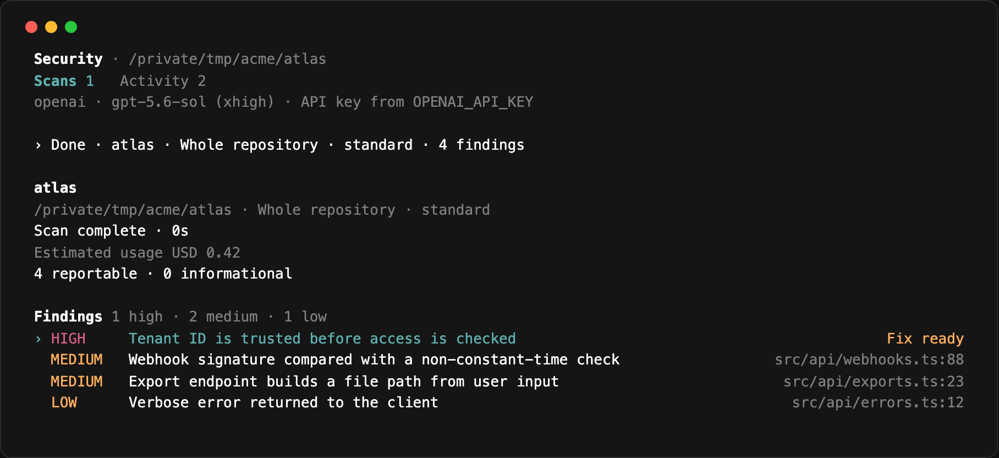
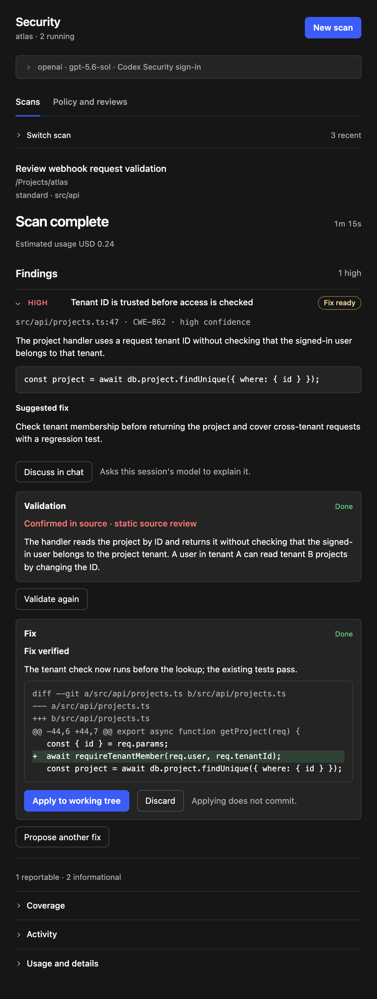
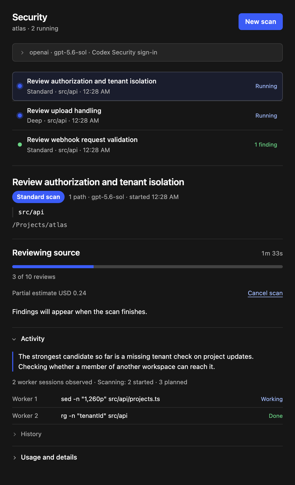

<h1 align="center">Codex Security for OpenCode</h1>

<p align="center">
  Find, confirm and fix security issues in your code without leaving OpenCode.<br>
  Ask for a scan in plain words, or drive it yourself from the terminal or the Desktop panel.
</p>

<p align="center">
  <a href="https://www.npmjs.com/package/opencode-codex-security"></a>
  <a href="LICENSE"></a>
  
</p>

<p align="center">
  
</p>

<p align="center"><sub>The terminal view after a scan. Screenshots use sample data.</sub></p>

It runs [Codex Security](https://developers.openai.com/codex/security) through the official [`@openai/codex-security`](https://www.npmjs.com/package/@openai/codex-security) SDK, using the model and provider you already have configured for Codex. This is an early, unofficial project, not an OpenCode or OpenAI product.

## Quick start

**1. Add the plugin** to the `plugins` array in `~/.config/opencode/opencode.json`:

```json
{ "plugins": [{ "package": "opencode-codex-security@latest" }] }
```

Then restart OpenCode.

**2. Open `/security`** in OpenCode. The top of the view shows the provider, model and credentials it will use, and tells you if anything is missing.

**3. Ask for a scan**, or press `n`:

```text
Run a security scan of this repo.
```

You see a preview of what will be scanned and where the source will be sent, and nothing starts until you approve it.

Scans need Python 3.10 or newer.

<details>
<summary><b>Have a coding agent install it</b></summary>

Paste this into your coding agent on the machine where you use OpenCode:

```text
Install the OpenCode plugin opencode-codex-security.

1. Add { "package": "opencode-codex-security@latest" } to the "plugins" array of my
   OpenCode config (~/.config/opencode/opencode.json, or under $XDG_CONFIG_HOME).
   Keep everything else in the file as it is.
2. Tell me to restart OpenCode and open /security to confirm it loaded.
3. If you are running inside OpenCode, after the restart call security_status and
   report what it says.

Don't start a scan or change my model provider or credentials. If something is
missing, tell me what it is.
```

</details>

<details>
<summary><b>Run it from source</b></summary>

Clone this repository, run `npm ci --ignore-scripts`, and set `package` to the checkout's absolute path. The built UI bundles are committed, so there is no build step.

</details>

## Just ask

The plugin gives your session's model the tools and a skill for the whole workflow, so you can describe what you want:

```text
Scan only what I changed on this branch against origin/main.
```

```text
Scan the billing service. It depends on the auth and ledger repos, and our
Terraform and GitOps repos describe how it is deployed.
```

```text
Is the tenant check finding real? If it is, propose a fix.
```

```text
Draft a SECURITY.md for services/api.
```

For the multi-repository case the model clones what is not checked out locally, reads the infrastructure repositories, writes a short deployment summary, and passes it to the scan as context. When a scan finishes, a notice lands in the conversation and the model reports the findings.

## What you can do

<table>
  <tr>
    <td width="46%" valign="top">
      
    </td>
    <td valign="top">

**Scan**

Standard or Deep. The whole repository, selected paths, your uncommitted changes, or everything since a branch or commit. Two scans can run at once.

**Review findings**

Most severe first, each with its location, evidence and a suggested fix. What you have done about a finding (confirmed, dismissed, fix ready, fix applied) is saved with the scan.

**Validate**

Re-check a finding against the source before you spend time on it.

**Fix**

The fix is written and verified in a throwaway copy of your last commit. You get a diff, and your files change only if you apply it. Nothing is committed.

**Draft a security policy**

A `SECURITY.md` for a repository or one component. It can ask you questions along the way, and it is never written for you.

**Discuss**

Hand any finding to the conversation and have the model explain it.

  </td>
  </tr>
</table>

<p align="center">
  
</p>

## Configuration

There is nothing to configure if Codex already works for you. The plugin uses the model and provider from `~/.codex/config.toml`, including gateways and Amazon Bedrock, and authenticates the way the SDK does: an API key from the environment, otherwise your Codex Security sign-in.

To choose a different model, a Codex profile, a default depth or a cost limit, add `~/.config/opencode/codex-security.json`:

```json
{
  "codex": { "profile": "work" },
  "scan": { "mode": "standard", "maxCostUsd": 5 }
}
```

Everything is in [docs/CONFIG.md](docs/CONFIG.md).

## In the terminal

`/security` opens the view, `/security-scan` starts a scan, `/security-policy` drafts a policy and `/security-validate` re-checks a finding. Inside the view everything is a key, and the footer shows the ones that apply to what is selected:

| Key       | Does                                                   |
| --------- | ------------------------------------------------------ |
| `n`       | New scan, with a review where you set target and scope |
| `enter`   | Move into the findings, then open one                  |
| `v` / `x` | Validate the finding / propose a fix                   |
| `y` / `r` | Apply / discard a proposed fix                         |
| `g`       | Discuss the finding in the conversation you came from  |
| `tab`     | Switch between scans and operations                    |
| `h`       | List every key available right now                     |

<details>
<summary><b>Tools for the session's model</b></summary>

| Tool                                                | Purpose                                                                       |
| --------------------------------------------------- | ----------------------------------------------------------------------------- |
| `security_status`                                   | The resolved route, config files, Codex profiles, and Node/Python found.      |
| `security_scan`                                     | Start a scan. Asks for your approval with the preview.                        |
| `security_scans`, `security_scan_status`            | List scans and follow one.                                                    |
| `security_scan_results`                             | Findings of a completed scan, or one finding in detail.                       |
| `security_policy`, `security_validate`              | Start a policy draft or a validation. Each asks first.                        |
| `security_fix`, `security_apply_fix`                | Propose a fix for a finding, then apply or discard the diff. Each asks first. |
| `security_operations`                               | Status, pending questions and results of those operations.                    |
| `security_answer_questions`                         | Answer a policy's owner questions. Asks first.                                |
| `security_cancel_scan`, `security_cancel_operation` | Cancel one run.                                                               |

Approvals use OpenCode's permission rules, under the actions `codex_security_scan`, `codex_security_policy`, `codex_security_validation`, `codex_security_fix`, `codex_security_apply_fix` and `codex_security_answer`.

Context files for a scan may be absolute paths in other checkouts. Any UTF-8 text file (Terraform, YAML, JSON, Markdown), PDF or DOCX works, and a directory contributes all of its text files.

</details>

## Good to know

- **Your source goes to your model provider.** Every scan, validation, fix and policy draft shows where, and waits for your approval.
- **Costs are estimates.** `scan.maxCostUsd` stops a scan on the SDK's estimate; it is not a billing cap. Validation and fixes have no cost limit.
- **Findings arrive when a scan completes**, not while it runs.
- **A fix is written against your last commit.** It does not see uncommitted work, and applying it fails cleanly if you have since changed the same lines.
- **Change scans run at Standard depth.**
- **Restarts.** Scan results and finding status are kept. A scan that was running is marked interrupted, and policy drafts, validations and unapplied fixes in progress are lost.
- **Runtimes.** Scans use Python 3.10+ and Node on the `PATH` OpenCode runs with. If either is missing or too old, the Security view says so.
- Tested on macOS and Linux. The Desktop panel is experimental.

## Development

```sh
npm ci --ignore-scripts
npm run check        # lint, format, types, unit tests, build
npm run setup:local  # one-time: isolated OpenCode under .runtime/
npm run test:host    # the plugin inside a real OpenCode server, with a mock SDK
```

See [CONTRIBUTING.md](CONTRIBUTING.md), [docs/ARCHITECTURE.md](docs/ARCHITECTURE.md) and [docs/RELEASING.md](docs/RELEASING.md). Released under [Apache 2.0](LICENSE).
